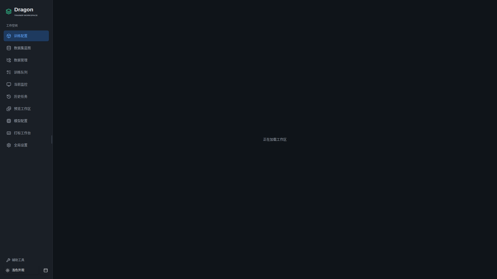
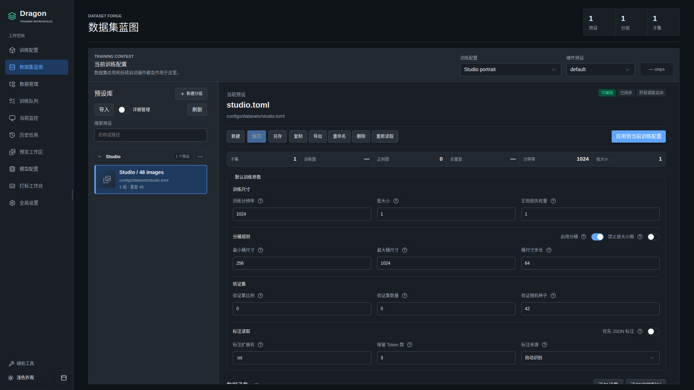
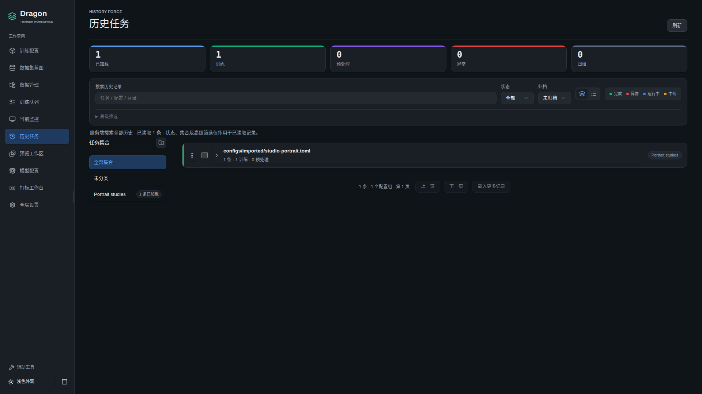
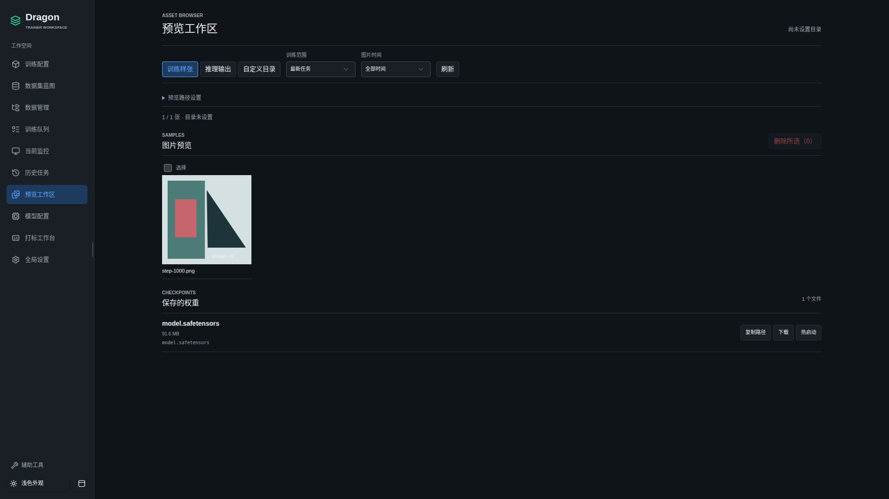
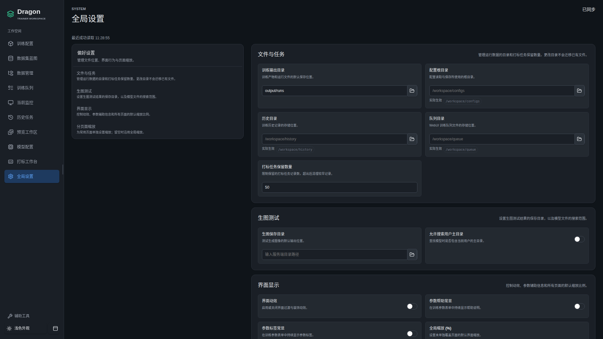
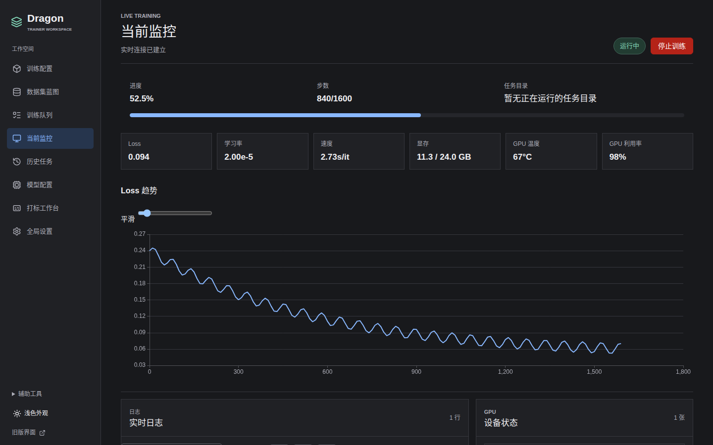
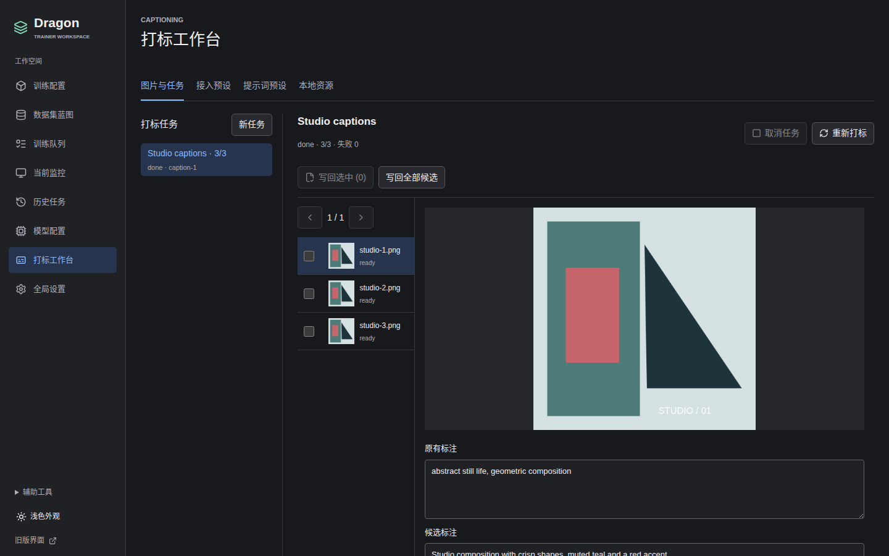
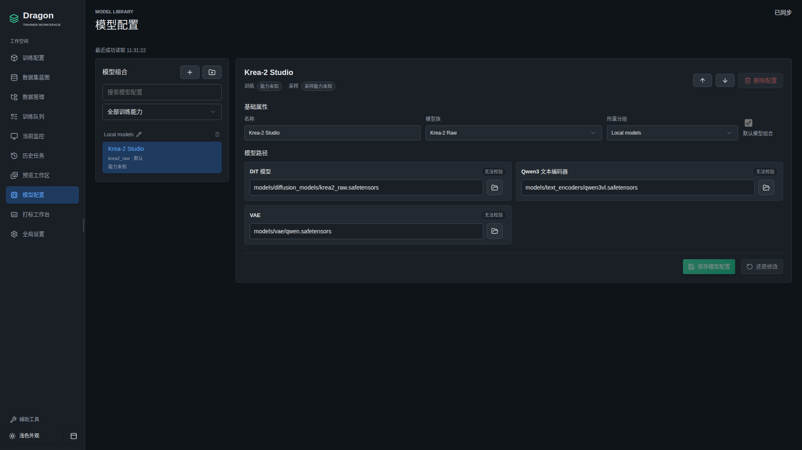
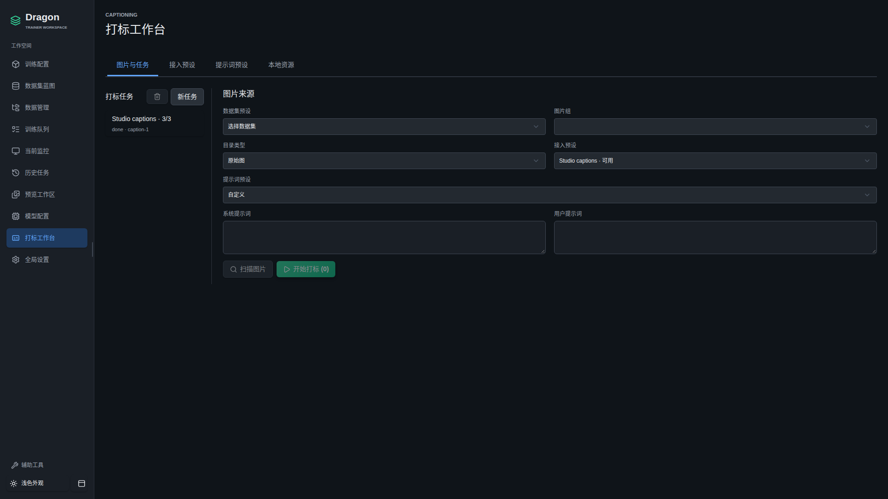

# Anima LoRA WebUI

这是一个支持 Anima、Krea-2、Z-Image、Qwen Image 2.1 和 MOSS-Image 的训练与 WebUI 项目，基于 [sorryhyun/anima_lora](https://github.com/sorryhyun/anima_lora#) 的 WebUI 前端扩展项目。不同模型族的训练、预览、推理和 adapter 能力，以模型族 registry 与配置预检为准。

感谢你选择我们的全绊屎山项目。它一定不优雅，但目标也不一定明确，项目尽量还能跑通，喜欢折腾，每天都在debug。

源码部署目前还没发行版。下面的界面截图来自当前 Next WebUI 的本地只读预览，统一使用 1920×1080 视口；当前代码会继续向前维护，谨慎更新 pull，随时做好回滚的准备。

交流QQ群:1104879801

后端会和欧巴的有些变动不完全对齐，作者偶尔会发挥主观能动性加点小巧思进来。

## 文档入口

完整文档从 [docs/README.md](docs/README.md) 进入；这里会按“安装使用、训练推理、方法说明、实验记录、配置、归档”分好路。

常用入口：

- 新手部署和 WebUI 使用：[Linux 部署启动](#linux-部署启动)、[Windows 部署启动](#windows-部署启动)
- Next WebUI 使用与维护入口：[web/frontend-next/README.md](web/frontend-next/README.md)
- Next 训练配置支持“分组视图 / 积木流视图”切换，连续浏览参数并通过阶段栏快速定位，见 [配置工作台](docs/features/config-workbench.md#next-react-配置工作台)。
- 训练页模型路径与缓存卡片适配宽窄屏，路径旁可浏览服务器模型目录；目录选择需更新后端接口，选择只改草稿，见 [配置工作台](docs/features/config-workbench.md#next-react-配置工作台)。
- 训练预检会提前识别新 NF4 权重与编译的冲突；可在启动确认中勾选风险确认后继续尝试，见[训练预检与风险确认](docs/features/config-workbench.md#训练预检与风险确认)。
- Next 数据集图片工作台：在 `/next/datasets` 对应子集进入「图片工作台」，统一提供图片预览、手动蒙版编辑和打标，见 [蒙版使用说明](docs/features/manual-mask-editor.md)。
- Linux 部署：[docs/guidelines/linux-deployment.zh.md](docs/guidelines/linux-deployment.zh.md)
- 训练参考：[docs/guidelines/training.md](docs/guidelines/training.md)
- 多模型能力边界：[docs/multi_model_support.md](docs/multi_model_support.md)
- 模型训练能力矩阵：[docs/configuration/model-training-capabilities.md](docs/configuration/model-training-capabilities.md)
- MOSS-Image 配置：[docs/configuration/moss-image.md](docs/configuration/moss-image.md)
- CLI 命令总览：`.venv/bin/python tasks.py --help`；配置诊断可用 `print-config`、`explain-config`、`config-compat`。
- AUTO 块交换（实验，默认关闭）：在 Next「设备与性能」配置，先独立预热再固定交换数；限制和验证状态见 [配置说明](docs/configuration/auto-block-swap.md)。
- 推理参考：[docs/guidelines/inference.md](docs/guidelines/inference.md)
- 文档归档：[docs/archive-index.md](docs/archive-index.md)

## 项目内容物预览：当前 Next WebUI

以下截图来自当前前端的本地只读预览，统一以 1920×1080 视口采集。页面使用合成数据，不会启动训练或写入用户配置；用于展示当前布局和主要工作区，不替代实际环境验收。

<table>
  <tr>
    <td width="33%">
      
      <br><sub>训练配置工作台</sub>
    </td>
    <td width="33%">
      
      <br><sub>数据集蓝图工作台</sub>
    </td>
    <td width="33%">
      
      <br><sub>历史任务与训练结果</sub>
    </td>
  </tr>
  <tr>
    <td width="33%">
      
      <br><sub>预览工作区</sub>
    </td>
    <td width="33%">
      
      <br><sub>全局设置与模型路径</sub>
    </td>
    <td width="33%">
      
      <br><sub>运行监控面板（深色主题示例）</sub>
    </td>
  </tr>
  <tr>
    <td width="33%">
      
      <br><sub>打标审阅工作台</sub>
    </td>
    <td width="33%">
      
      <br><sub>模型配置与能力</sub>
    </td>
    <td width="33%">
      
      <br><sub>打标工作台</sub>
    </td>
  </tr>
</table>

## 当前模型与能力

模型族由 `library/models/family_registry.py` 统一注册，未知组合会在配置预检或运行时明确拒绝，不会静默回退到 Anima：

- **Anima**：默认生产族，支持完整训练与 `single` / `batch` / `interactive` 推理。
- **Krea-2 Raw**：独立训练与 `single`/Euler 推理，网络变体和显存策略以兼容矩阵为准。
- **Z-Image**：训练与训练预览 v1；尚未注册通用 image-test 或独立推理入口。
- **Qwen Image 2.1**：T2I/Edit 训练与训练预览；Edit 支持 1–4 张参考图，独立推理为 `single`/Euler，当前以 plain LoRA 为稳定边界。
- **MOSS-Image**：普通文生图 plain LoRA 首版，支持 BF16/NF4 文本编码器缓存路径；普通推理/image-test 尚未注册。

此外，项目提供：

1. LoRA、LoKr，以及定位为兼容能力的 LoHa（训练 / 保存 / 静态 merge / WebUI 变体）；详见 `docs/methods/`。
2. WebUI 中的训练方法、硬件预设、数据集配置、模型路径和 sample prompts 管理。
3. 图片 resize、VAE latent 缓存、文本编码缓存、PE 特征缓存和 caption index 构建。
4. 训练队列、任务日志、历史任务分组、失败/中断任务续训和运行状态查看。
5. 训练结果预览、权重选择、prompt 预览和按模型族隔离的推理入口。
6. 命令行自动化、实验 bench、ComfyUI custom nodes、结构文档和 pytest 测试。

推理能力按模型族隔离：Anima 使用通用 `inference.py` 示例，Qwen Image 2.1 的 T2I/Edit 使用专用参数；Z-Image 与 MOSS-Image 当前不提供通用 image-test/独立推理入口。详见 [推理参考](docs/guidelines/inference.md)。

## 致谢 / “抄袭”列表

不会做还不会抄吗？问题不大的啦：

- [sorryhyun/anima_lora](https://github.com/sorryhyun/anima_lora#)：当前项目的主要基础，WebUI 前端和 Anima LoRA 训练管线都基于它继续扩展。
  [https://github.com/WhitecrowAurora/lulynx-trainer](https://github.com/WhitecrowAurora/lulynx-trainer) ：本项目非常重要的优化来源
  [MonadForge](https://github.com/LingyeSoul/MonadForge)：lokr换血优化，提升450%速度，伟大的G8炉。
- [Moeblack/AnimaLoraToolkit](https://github.com/Moeblack/AnimaLoraToolkit)：参考了 Anima LoRA 训练工具链、lokr支持，配置组织和使用体验。
- [huggingface/peft](https://github.com/huggingface/peft)：loha兼容支持。
  [DNPMBHC/DiffPipeForge](https://github.com/DNPMBHC/DiffPipeForge) :dpf的一个分支,从中抄袭了块交换缓存和环境检测
- [TianDongL/DiffPipeForge](https://github.com/TianDongL/DiffPipeForge)：参考了数据处理、训练流程和部分工程组织思路。
- [LoganBooker/prodigy-plus-schedule-free](https://github.com/LoganBooker/prodigy-plus-schedule-free)：用于 Prodigy Plus Schedule-Free 优化器支持。
- [kozistr/pytorch_optimizer](https://github.com/kozistr/pytorch_optimizer)：用于 CAME 等 `pytorch-optimizer` 优化器支持。

## Linux 部署启动

建议使用 NVIDIA 显卡，并先确认驱动可用：

```bash
nvidia-smi
```

安装基础工具：

```bash
sudo apt update
sudo apt install -y git git-lfs curl wget build-essential python3 python3-venv python3-pip libgl1 libglib2.0-0
git lfs install
```

安装 `uv`：

```bash
curl -LsSf https://astral.sh/uv/install.sh | sh
source "$HOME/.local/bin/env"
uv --version
```

克隆项目并安装依赖：

```bash
git clone https://github.com/scvxzf1/anima_lora_webui.git
cd anima_lora_webui
git lfs pull
uv sync
```

检查 CUDA：

```bash
.venv/bin/python -c "import torch; print(torch.__version__); print(torch.version.cuda); print(torch.cuda.is_available())"
```

登录 Hugging Face 并下载默认模型：

```bash
.venv/bin/hf auth login
.venv/bin/python tasks.py download-models
```

需要 Krea-2 时，再执行：

```bash
.venv/bin/python tasks.py download-krea2
```

启动 WebUI：

```bash
./webui.sh
```

`webui.sh` 默认会构建 Next 前端，因此需要 Node.js 22.13+ 和 pnpm 11。若已有构建产物、只想启动后端，可跳过构建：

```bash
ANIMA_WEB_BUILD_FRONTEND=0 ./webui.sh
```

当前代码中的快捷脚本 `webui.sh` 默认监听 `127.0.0.1:20203`，等待 Next 就绪后打开 `/next`；这是本仓库脚本行为，不代表线上该端口已部署或切换。只启动服务、不打开浏览器时使用 `ANIMA_WEB_OPEN_BROWSER=0 ./webui.sh`。

直接运行 `./start_webui.sh` 时默认端口是 `20103`；手动运行 `tasks.py web` 时默认端口是 `20102`。日常使用优先选择 `./webui.sh`，它会先构建前端并等待 Next 页面就绪。

也可以手动指定监听地址和端口：

```bash
.venv/bin/python tasks.py web --host 127.0.0.1 --port 20102
```

浏览器打开：

```text
http://127.0.0.1:20102/
```

访问根路径会进入 Next UI。首次启动加载后端依赖时可能需要等待约 10–40 秒。旧 `/?ui=dragon` 和 `/?ui=classic` 地址目前仅作为兼容输入重定向到 Next，不会启动旧界面。

需要局域网访问时：

```bash
export ANIMA_WEBUI_TOKEN='替换为足够长的随机令牌'
.venv/bin/python tasks.py web --host 0.0.0.0 --port 20102
```

非本机回环地址必须设置 `ANIMA_WEBUI_TOKEN` 或传入 `--token`，否则服务会拒绝启动。首次从其他机器访问时可使用 `?token=...` 完成认证；不要把真实令牌提交到仓库或写进共享文档。

Tesla V100 必须使用独立的 Python 3.13 / Torch 2.10 + CUDA 12.9
环境，不要在该环境中执行普通 `uv sync`：

```bash
./setup-v100-linux.sh
```

V100 生产训练仍建议 `attn_mode="torch"`。源码版 Flash 只用于诊断和
严格验收，详见 [V100 FlashAttention 支持边界](docs/findings/v100_flash_attention_support.md)。

## Windows 部署启动

建议使用 PowerShell。先安装：

- NVIDIA 显卡驱动，并确认 `nvidia-smi` 可用。
- Git for Windows，安装后执行 `git lfs install`。
- Python 不需要手动单独管理，项目依赖优先交给 `uv`。

安装 `uv`：

```powershell
powershell -ExecutionPolicy ByPass -c "irm https://astral.sh/uv/install.ps1 | iex"
uv --version
```

克隆项目并安装依赖：

```powershell
git clone https://github.com/scvxzf1/anima_lora_webui.git
cd anima_lora_webui
git lfs pull
uv sync
```

检查 CUDA：

```powershell
.\.venv\Scripts\python.exe -c "import torch; print(torch.__version__); print(torch.version.cuda); print(torch.cuda.is_available())"
```

登录 Hugging Face 并下载默认模型：

```powershell
.\.venv\Scripts\hf.exe auth login
.\.venv\Scripts\python.exe tasks.py download-models
```

启动 WebUI：

```powershell
.\.venv\Scripts\python.exe tasks.py web --host 127.0.0.1 --port 20102
```

浏览器打开：

```text
http://127.0.0.1:20102/
```

默认进入 Next UI。旧 `/?ui=dragon` 和 `/?ui=classic` 地址仅会重定向到 Next，不提供旧界面。

如果 PowerShell 禁止激活脚本，不需要激活虚拟环境，直接使用上面的 `.\.venv\Scripts\python.exe` 命令即可。

## 启动后怎么用

当前用户界面为 Next。Next 页面中的错误恢复入口用于返回训练配置；界面使用说明和开发、验收命令见 [Next 前端 README](web/frontend-next/README.md)。旧版 Dragon/classic 的实现记录保留在[退役指南](docs/features/dragon-ui.md)，仅供维护历史参考。

1. 在 WebUI 里确认基础模型、文本编码器和 VAE 路径。
2. 导入或创建数据集配置。
3. 先执行预处理，生成训练缓存。
4. 选择训练方法和硬件预设。
5. 加入训练队列或直接启动训练。
6. 在历史任务里查看日志、曲线、预览图和续训入口。

默认模型路径：

```text
models/diffusion_models/anima-base-v1.0.safetensors
models/text_encoders/qwen_3_06b_base.safetensors
models/vae/qwen_image_vae.safetensors
```

上述路径对应默认 Anima 配置。Krea-2、Z-Image、Qwen Image 2.1 和 MOSS-Image 使用各自方法配置中的组件路径，请以 `configs/methods/` 和对应配置文档为准。如果模型放在别处，可以在 WebUI 的 **全局模型配置** 中改成实际路径。
