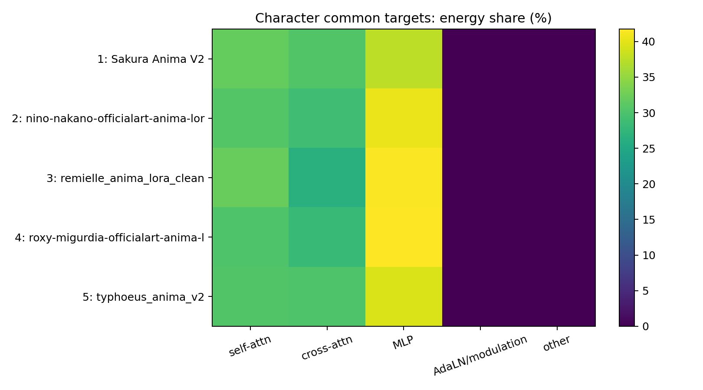
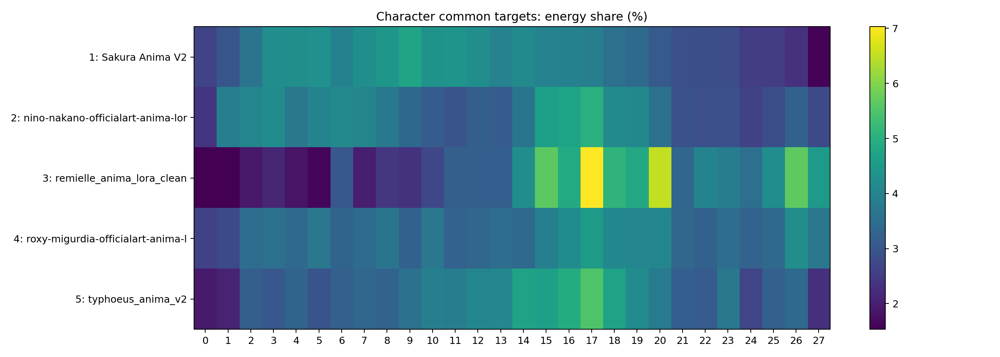
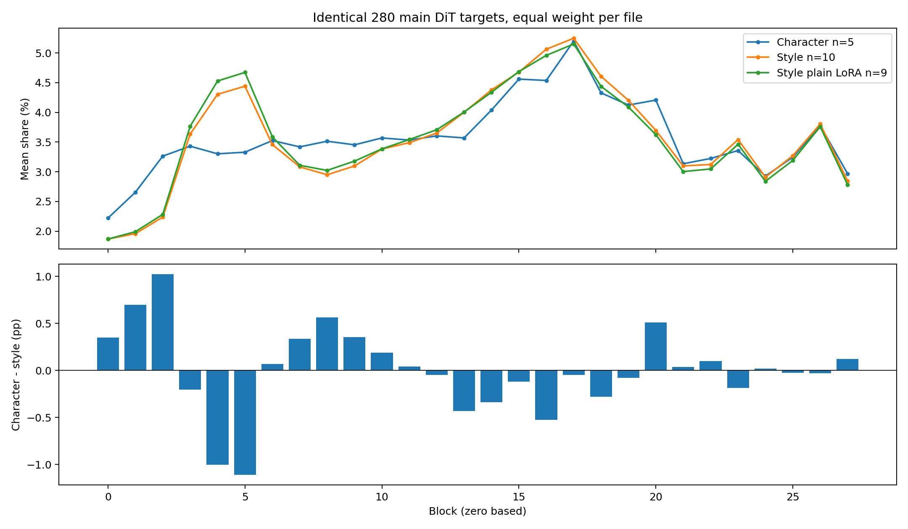
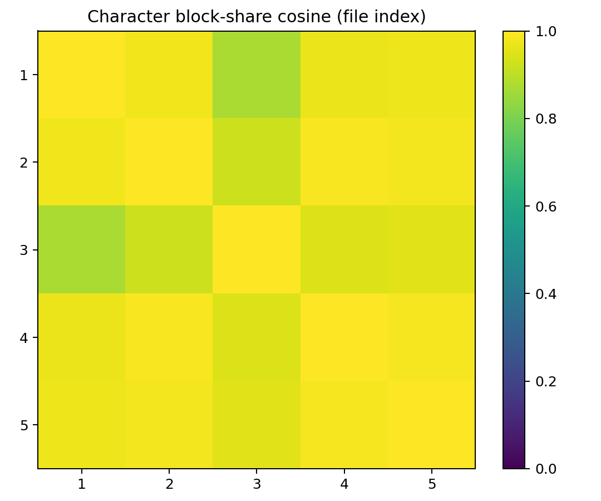

# Anima 人物权重展开静态分析与画风对照

状态：历史调查快照
适用范围：2026-10-01 本批静态权重分析

> 历史调查快照：2026-10-01。保留当时的数值、样本与结论；此副本仅整理导航和复现说明，不代表当前代码的重新验收。

[分类导航](../README.md) · [两组汇总](../summary.md)

## 核心结论与逐文件对比

5个人物权重、1,568个模块全部完成有效ΔW分析，无非有限值、不支持模块或遗漏参数。以下人物与画风比较统一到全部15文件共同的280个attention/MLP目标，每文件先归一化再等权汇总。

|模块|人物均值%|画风均值%|人物减画风（百分点）|
|---|---:|---:|---:|
|MLP|40.16|43.98|-3.83|
|self-attn|31.04|28.78|+2.26|
|cross-attn|28.81|27.24|+1.57|

**最稳定的层共性：** 人物block17和18均在4/5文件中进入各自更新能量前五；画风同样偏重17/16/18。block均从0计数。人物的各文件整体分布仍有不同，不能把所有角色看成同一层分布。

|人物|MLP%|self-attn%|cross-attn%|共同目标前三block|top5能量占比%|
|---|---:|---:|---:|---|---:|
|Sakura|37.63|31.90|30.47|9, 8, 11|22.23|
|nino|40.51|30.63|28.86|17, 16, 15|22.74|
|remielle|41.49|32.08|26.43|17, 20, 26|29.97|
|roxy|41.74|30.20|28.06|17, 26, 16|21.13|
|typhoeus|39.42|30.37|30.20|17, 16, 14|24.50|

**人物样本差异：** Sakura偏中前段block9/8/11，且额外训练了168个AdaLN模块；完整覆盖下AdaLN占33.86%，其他四份没有保存AdaLN更新，不能将它们的缺失视作低敏感。remielle更集中，top5占29.97%；roxy更分散，top5占21.13%。

## 人物与画风差异的稳健性检查

原画风样本包含ba_nai这个早层MLP集中更新的例外，因此补充“仅暂时排除ba_nai”的描述性对照（画风n=9，仍包含LoKr；区别于普通LoRA子集）。并未删除原始样本，全体结果保留。

|模块|人物均值%|排除ba_nai后画风均值%|差值（百分点）|
|---|---:|---:|---:|
|MLP|40.16|40.60|-0.45|
|self-attn|31.04|30.48|+0.56|
|cross-attn|28.81|28.92|-0.11|

排除这一个例外后，三组模块占比差均小于0.6个百分点；人物和画风的MLP中位数也接近（40.51%与40.66%）。本批次更有证据的结论是两组大体相似，少数模型决定了均值差异；不能认定人物训练必然比画风更依赖attention。

## 基座来源与独立验收

人物nino、roxy、typhoeus的ss_new_sd_model_hash相同，均为bd43b7cf…90a006e，且与此前画风的AddMicroDetails、mixed_styles、ba_nai、sky一致。Sakura无此完整hash，remielle无metadata；模型族或文件名相同不足以证明全部同源。sshs_model_hash为adapter自身hash，不用于判定基座。

主代理按两组逐层CSV重新计算共同模块占比，全部一致；5个真实人物权重各抽一模块直接重建ΔW核验，最大相对误差4.09e-7。详细记录见[independent_validation.json](evidence/independent_validation.json)。

人物 5 文件，460.3 MB；对照画风 10 文件。CPU 最多4线程，未加载基座、未使用GPU、未训练、未做全量SVD。

静态等价更新 ΔW=(alpha/rank)BA，multiplier=1；Fro能量用小Gram矩阵计算，FP32矩阵乘、FP64归约；LoKr沿用已验收的 Kronecker 范数公式。alpha优先tensor，其次metadata，具体来源逐模块记录。绝对范数不是质量、人物还原度或风格强弱排名；没有基座范数、激活、图片验证，不能作因果敏感性结论。

主DiT严格锚定 blocks_数字，llm_adapter等不混入block；dot/underscore命名统一canonical，本批人物未发现fused qkv/kv、DoRA/magnitude/router/inv_scale张量。所有张量完整检查finite；保存配对、shape、不支持模块和未消费键列表。配置rank不是数值有效秩。

## 每文件规模与静态更新

|文件|类型|主DiT/总模块|rank|alpha|scale|Fro|RMS|参数量（不含alpha）|
|---|---|---:|---|---|---|---:|---:|---:|
|Sakura Anima V2.safetensors|LoRA|448/448|32–32|32–32|1–1|18.8856|0.000429023|69,271,552|
|nino-nakano-officialart-anima-lora-nochekaiser.safetensors|LoRA|280/280|32–32|32–32|1–1|11.3411|0.00027021|45,875,200|
|remielle_anima_lora_clean.safetensors|LoRA|280/280|16–16|8–8|0.5–0.5|5.33608|0.000127136|22,937,600|
|roxy-migurdia-officialart-anima-lora-nochekaiser.safetensors|LoRA|280/280|32–32|32–32|1–1|10.3961|0.000247695|45,875,200|
|typhoeus_anima_v2.safetensors|LoRA|280/280|32–32|32–32|1–1|8.76724|0.000208885|45,875,200|

### 1. Sakura Anima V2.safetensors

- 模型族依据：metadata。tensor数 1344，重建 448/448；alpha来源：tensor
- rank分布：{"32": 448}；alpha分布：{"32.0": 448}
- 模块组（该文件全部可重建更新为分母）：AdaLN/modulation 33.86%；MLP 24.89%；self-attn 21.10%；cross-attn 20.16%
- top5 blocks：8 4.49%；9 4.47%；14 4.31%；10 4.26%；12 4.20%
- top10模块：blocks_4_mlp_layer1 0.93%；blocks_9_mlp_layer1 0.86%；blocks_10_mlp_layer1 0.86%；blocks_11_mlp_layer1 0.86%；blocks_3_mlp_layer1 0.85%；blocks_5_mlp_layer1 0.84%；blocks_12_mlp_layer1 0.83%；blocks_16_mlp_layer1 0.82%；blocks_7_mlp_layer1 0.82%；blocks_8_mlp_layer1 0.82%
- 可用元信息：`{"ss_base_model_version": "anima", "modelspec.architecture": "stable-diffusion-v1/lora", "ss_network_module": "networks.lora_anima", "ss_network_dim": "32", "ss_network_alpha": "32", "ss_steps": "2235", "ss_epoch": "15", "ss_num_epochs": "15", "ss_learning_rate": "3e-05", "ss_mixed_precision": "bf16", "modelspec.resolution": "512x512", "modelspec.date": "2026-09-16T18:16:02", "ss_optimizer": "pytorch_optimizer.optimizer.came.CAME(weight_decay=0.05)", "ss_lr_scheduler": "cosine", "network_args_safe": {"rank_dropout": "0.1", "dropout": null}, "ss_training_started_at": "1789567952.261766", "ss_training_finished_at": "1789575362.8797467", "sshs_model_hash": "789d1ad8c7c279f4d2aae59bdaffc47e6366f2f897031c8781c4d9e2af77e99e", "sshs_legacy_hash": "de857cf1", "ss_sd_scripts_commit_hash": "1eeb4b264a50ea32cd157fb4fbe802c5dbeda35f"}`

### 2. nino-nakano-officialart-anima-lora-nochekaiser.safetensors

- 模型族依据：metadata。tensor数 840，重建 280/280；alpha来源：tensor
- rank分布：{"32": 280}；alpha分布：{"32.0": 280}
- 模块组（该文件全部可重建更新为分母）：MLP 40.51%；self-attn 30.63%；cross-attn 28.86%
- top5 blocks：17 5.03%；16 4.72%；15 4.63%；3 4.20%；18 4.16%
- top10模块：blocks_17_mlp_layer1 1.87%；blocks_16_mlp_layer1 1.81%；blocks_18_mlp_layer1 1.69%；blocks_15_mlp_layer1 1.66%；blocks_19_mlp_layer1 1.60%；blocks_14_mlp_layer1 1.35%；blocks_20_mlp_layer1 1.26%；blocks_3_self_attn_k_proj 1.11%；blocks_24_mlp_layer1 1.10%；blocks_1_cross_attn_q_proj 1.07%
- 可用元信息：`{"ss_base_model_version": "anima", "modelspec.architecture": "anima-preview/lora", "ss_network_module": "networks.lora_anima", "ss_network_dim": "32", "ss_network_alpha": "32", "ss_steps": "1000", "ss_epoch": "10", "ss_num_epochs": "10", "ss_learning_rate": "0.0001", "ss_mixed_precision": "bf16", "modelspec.resolution": "1024x1024", "modelspec.date": "2026-09-04T16:17:22", "ss_optimizer": "bitsandbytes.optim.adamw.AdamW8bit(weight_decay=0.1)", "ss_lr_scheduler": "constant", "network_args_safe": {}, "ss_new_sd_model_hash": "bd43b7cffe1ed1153d9c41e7beb2f18cb1273eafbaa3af3edd6a173dc90a006e", "ss_sd_model_hash": "c73d1385", "ss_new_vae_hash": "a70580f0213e67967ee9c95f05bb400e8fb08307e017a924bf3441223e023d1f", "ss_training_started_at": "1788508765.476609", "sshs_legacy_hash": "fbeb3c0a", "ss_training_finished_at": "1788509842.7983837", "ss_vae_hash": "05dc78c1", "ss_sd_scripts_commit_hash": "81e6ad746dc64dc9ea2136effa376bc46ffad0fb", "sshs_model_hash": "cf58755ab8cefa5ff768a661150d88894adb367c901d131e177169607b54caad", "ss_sd_model_name": "anima_baseV10.safetensors"}`

### 3. remielle_anima_lora_clean.safetensors

- 模型族依据：inferred: 28 blocks, 2048 hidden, Anima AdaLN/cross-attn naming; metadata absent。tensor数 840，重建 280/280；alpha来源：tensor
- rank分布：{"16": 280}；alpha分布：{"8.0": 280}
- 模块组（该文件全部可重建更新为分母）：MLP 41.49%；self-attn 32.08%；cross-attn 26.43%
- top5 blocks：17 7.03%；20 6.52%；26 5.66%；15 5.65%；18 5.11%
- top10模块：blocks_15_mlp_layer1 2.53%；blocks_17_mlp_layer1 2.44%；blocks_20_cross_attn_output_proj 2.26%；blocks_16_mlp_layer1 2.05%；blocks_18_mlp_layer1 2.03%；blocks_26_mlp_layer1 1.95%；blocks_19_mlp_layer1 1.95%；blocks_25_mlp_layer1 1.79%；blocks_14_mlp_layer1 1.72%；blocks_20_mlp_layer1 1.69%
- 可用元信息：`{"network_args_safe": {}}`

### 4. roxy-migurdia-officialart-anima-lora-nochekaiser.safetensors

- 模型族依据：metadata。tensor数 840，重建 280/280；alpha来源：tensor
- rank分布：{"32": 280}；alpha分布：{"32.0": 280}
- 模块组（该文件全部可重建更新为分母）：MLP 41.74%；self-attn 30.20%；cross-attn 28.06%
- top5 blocks：17 4.53%；26 4.24%；16 4.21%；18 4.09%；19 4.05%
- top10模块：blocks_17_mlp_layer1 1.77%；blocks_18_mlp_layer1 1.68%；blocks_16_mlp_layer1 1.63%；blocks_19_mlp_layer1 1.57%；blocks_15_mlp_layer1 1.52%；blocks_26_mlp_layer1 1.48%；blocks_24_mlp_layer1 1.41%；blocks_20_mlp_layer1 1.39%；blocks_25_mlp_layer1 1.34%；blocks_23_mlp_layer1 1.32%
- 可用元信息：`{"ss_base_model_version": "anima", "modelspec.architecture": "anima-preview/lora", "ss_network_module": "networks.lora_anima", "ss_network_dim": "32", "ss_network_alpha": "32", "ss_steps": "900", "ss_epoch": "10", "ss_num_epochs": "10", "ss_learning_rate": "0.0001", "ss_mixed_precision": "bf16", "modelspec.resolution": "1024x1024", "modelspec.date": "2026-09-19T23:30:33", "ss_optimizer": "bitsandbytes.optim.adamw.AdamW8bit(weight_decay=0.1)", "ss_lr_scheduler": "constant", "network_args_safe": {}, "ss_training_started_at": "1789830924.7207325", "ss_sd_model_hash": "c73d1385", "ss_sd_model_name": "anima_baseV10.safetensors", "ss_training_finished_at": "1789831833.900995", "ss_new_vae_hash": "a70580f0213e67967ee9c95f05bb400e8fb08307e017a924bf3441223e023d1f", "ss_vae_hash": "05dc78c1", "sshs_legacy_hash": "a0e035ba", "ss_sd_scripts_commit_hash": "81e6ad746dc64dc9ea2136effa376bc46ffad0fb", "sshs_model_hash": "cba478fe674b406aaf629434513ac15b0013194273f7283967198cc6fc107ea4", "ss_new_sd_model_hash": "bd43b7cffe1ed1153d9c41e7beb2f18cb1273eafbaa3af3edd6a173dc90a006e"}`

### 5. typhoeus_anima_v2.safetensors

- 模型族依据：metadata。tensor数 840，重建 280/280；alpha来源：tensor
- rank分布：{"32": 280}；alpha分布：{"32.0": 280}
- 模块组（该文件全部可重建更新为分母）：MLP 39.42%；self-attn 30.37%；cross-attn 30.20%
- top5 blocks：17 5.52%；16 4.92%；14 4.73%；18 4.70%；15 4.63%
- top10模块：blocks_16_mlp_layer1 2.01%；blocks_17_mlp_layer1 1.94%；blocks_18_mlp_layer1 1.88%；blocks_14_mlp_layer1 1.73%；blocks_15_mlp_layer1 1.68%；blocks_13_mlp_layer1 1.63%；blocks_19_mlp_layer1 1.61%；blocks_20_mlp_layer1 1.33%；blocks_11_mlp_layer1 1.32%；blocks_25_mlp_layer1 1.30%
- 可用元信息：`{"ss_base_model_version": "anima", "modelspec.architecture": "anima-preview/lora", "ss_network_module": "networks.lora_anima", "ss_network_dim": "32", "ss_network_alpha": "32.0", "ss_steps": "1584", "ss_epoch": "6", "ss_num_epochs": "6", "ss_learning_rate": "0.0001", "ss_mixed_precision": "bf16", "modelspec.resolution": "1024x1024", "modelspec.date": "2026-09-03T20:54:32", "ss_optimizer": "bitsandbytes.optim.adamw.AdamW8bit", "ss_lr_scheduler": "cosine_with_restarts", "network_args_safe": {}, "sshs_model_hash": "989444038a78e588d108a93cdde85ee3af66636fcfe74103dd6b81b96f9b0fad", "sshs_legacy_hash": "39171839", "ss_sd_model_name": "anima-base-v1.0.safetensors", "ss_vae_hash": "05dc78c1", "ss_training_started_at": "1788453210.378638", "ss_training_finished_at": "1788461672.143487", "ss_new_vae_hash": "a70580f0213e67967ee9c95f05bb400e8fb08307e017a924bf3441223e023d1f", "ss_sd_model_hash": "c73d1385", "ss_new_sd_model_hash": "bd43b7cffe1ed1153d9c41e7beb2f18cb1273eafbaa3af3edd6a173dc90a006e", "ss_sd_scripts_commit_hash": "cad32ee577e32b0c46bf3a734d37a9c2a1c095f9"}`

## 人物内部共同目标分布与一致性

n=5；共同主DiT目标 280 个。先在共同目标内按每文件能量归一化，再等权计算，不混加原始能量。

|模块组|mean%|median%|Q25–Q75%|IQR百分点|
|---|---:|---:|---:|---:|
|MLP|40.157|40.506|39.422–41.492|2.069|
|self-attn|31.037|30.631|30.373–31.901|1.528|
|cross-attn|28.806|28.863|28.058–30.205|2.147|
|AdaLN/modulation|0.000|0.000|0.000–0.000|0.000|
|other|0.000|0.000|0.000–0.000|0.000|

|block|mean%|median%|Q25–Q75%|进入文件top5次数|
|---|---:|---:|---:|---:|
|17|5.199|5.028|4.531–5.521|4/5|
|15|4.559|4.628|3.971–4.633|3/5|
|16|4.536|4.719|4.214–4.890|3/5|
|18|4.327|4.163|4.091–4.697|4/5|
|20|4.206|3.795|3.582–4.051|1/5|
|19|4.122|4.092|4.052–4.191|1/5|
|14|4.039|4.141|3.668–4.241|1/5|
|26|3.775|3.419|3.241–4.240|2/5|
|12|3.603|3.354|3.187–4.052|0/5|
|10|3.569|3.721|3.130–3.913|1/5|
|13|3.569|3.489|3.173–3.970|0/5|
|11|3.533|3.269|3.201–3.856|1/5|
|6|3.525|3.311|3.227–3.940|0/5|
|8|3.514|3.677|3.289–3.763|1/5|
|9|3.453|3.359|3.247–3.592|1/5|
|3|3.430|3.558|3.031–4.199|1/5|
|7|3.418|3.450|3.349–4.024|0/5|
|23|3.357|3.487|2.880–3.732|0/5|
|5|3.329|3.712|2.959–4.023|1/5|
|4|3.302|3.408|3.307–3.735|0/5|
|2|3.263|3.497|3.203–3.640|0/5|
|25|3.246|3.214|2.851–3.402|0/5|
|22|3.224|3.130|2.884–3.230|0/5|
|21|3.134|3.177|2.916–3.350|0/5|
|27|2.967|2.772|2.289–3.712|0/5|
|24|2.927|2.691|2.604–3.259|0/5|
|1|2.655|2.763|2.070–2.996|0/5|
|0|2.220|2.381|1.931–2.597|0/5|

|文件|top5 block能量占比%|effective block count|
|---|---:|---:|
|Sakura Anima V2.safetensors|22.230|26.698|
|nino-nakano-officialart-anima-lora-nochekaiser.safetensors|22.737|27.042|
|remielle_anima_lora_clean.safetensors|29.967|23.751|
|roxy-migurdia-officialart-anima-lora-nochekaiser.safetensors|21.128|27.614|
|typhoeus_anima_v2.safetensors|24.501|26.551|

effective block count=1/sum(block_share²)，衡量能量集中度，不是权重有效秩；均匀28层为28。top5以每文件各自热点选取。

共同目标top10模块热点出现次数（每文件各取10，模块很多时次数小不等于不存在一致性）：blocks_16_mlp_layer1: 5/5；blocks_17_mlp_layer1: 4/5；blocks_18_mlp_layer1: 4/5；blocks_15_mlp_layer1: 4/5；blocks_19_mlp_layer1: 4/5；blocks_20_mlp_layer1: 4/5；blocks_14_mlp_layer1: 3/5；blocks_25_mlp_layer1: 3/5；blocks_11_mlp_layer1: 2/5；blocks_24_mlp_layer1: 2/5；blocks_26_mlp_layer1: 2/5；blocks_4_mlp_layer1: 1/5；blocks_9_mlp_layer1: 1/5；blocks_10_mlp_layer1: 1/5；blocks_3_mlp_layer1: 1/5；blocks_5_mlp_layer1: 1/5；blocks_12_mlp_layer1: 1/5；blocks_7_mlp_layer1: 1/5；blocks_8_mlp_layer1: 1/5；blocks_3_self_attn_k_proj: 1/5

人物与两组共同目标集合均为相同280个，人物分布沿用上节，不重复列表。

## 人物与画风真正共同目标：画风全部

n=10；共同主DiT目标 280 个。先在共同目标内按每文件能量归一化，再等权计算，不混加原始能量。

|模块组|mean%|median%|Q25–Q75%|IQR百分点|
|---|---:|---:|---:|---:|
|MLP|43.983|40.662|37.966–42.048|4.082|
|self-attn|28.779|29.743|29.273–31.147|1.875|
|cross-attn|27.238|28.352|22.531–33.074|10.544|
|AdaLN/modulation|0.000|0.000|0.000–0.000|0.000|
|other|0.000|0.000|0.000–0.000|0.000|

|block|mean%|median%|Q25–Q75%|进入文件top5次数|
|---|---:|---:|---:|---:|
|17|5.247|5.783|4.420–6.067|9/10|
|16|5.061|5.482|4.361–5.910|9/10|
|15|4.677|4.871|4.335–5.284|6/10|
|18|4.606|4.627|4.360–5.103|8/10|
|5|4.440|2.846|2.596–3.247|1/10|
|14|4.377|4.468|4.119–4.859|6/10|
|4|4.303|2.661|2.321–3.137|1/10|
|19|4.201|4.381|4.226–4.421|2/10|
|13|4.001|4.068|3.910–4.390|0/10|
|26|3.803|3.957|3.535–4.348|3/10|
|20|3.695|3.873|3.532–4.107|0/10|
|12|3.650|3.817|3.644–4.063|0/10|
|3|3.633|2.478|2.329–2.900|1/10|
|23|3.540|3.368|3.249–4.096|1/10|
|11|3.490|3.689|3.365–3.916|0/10|
|6|3.457|2.918|2.664–3.560|1/10|
|10|3.381|3.530|3.272–3.770|0/10|
|25|3.271|3.312|2.791–3.943|0/10|
|22|3.122|3.011|2.907–3.787|0/10|
|21|3.097|3.170|2.796–3.600|0/10|
|9|3.097|3.260|2.755–3.377|0/10|
|7|3.082|3.027|2.833–3.259|1/10|
|8|2.949|3.030|2.516–3.403|0/10|
|24|2.909|2.755|2.497–3.478|0/10|
|27|2.845|2.548|2.180–3.177|1/10|
|2|2.238|2.370|2.093–2.491|0/10|
|1|1.958|2.003|1.714–2.318|0/10|
|0|1.868|2.033|1.464–2.267|0/10|

## 两组差异（人物减画风，百分点）

严格使用全部 15 文件主DiT共同canonical交集 280 targets。不同覆盖分母不可直接比较；这里每个文件都在同一交集重归一化。

|模块组|人物mean%|画风mean%|差值百分点|普通LoRA画风mean%（n=9）|
|---|---:|---:|---:|---:|
|self-attn|31.037|28.779|+2.258|28.618|
|cross-attn|28.806|27.238|+1.569|28.087|
|MLP|40.157|43.983|-3.826|43.296|
|AdaLN/modulation|0.000|0.000|+0.000|0.000|
|other|0.000|0.000|+0.000|0.000|

|block|人物mean%|画风mean%|差值百分点|
|---|---:|---:|---:|
|5|3.329|4.440|-1.111|
|2|3.263|2.238|+1.025|
|4|3.302|4.303|-1.001|
|1|2.655|1.958|+0.697|
|8|3.514|2.949|+0.565|
|16|4.536|5.061|-0.525|
|20|4.206|3.695|+0.511|
|13|3.569|4.001|-0.432|
|9|3.453|3.097|+0.356|
|0|2.220|1.868|+0.352|
|14|4.039|4.377|-0.338|
|7|3.418|3.082|+0.336|
|18|4.327|4.606|-0.278|
|3|3.430|3.633|-0.203|
|10|3.569|3.381|+0.187|
|23|3.357|3.540|-0.184|
|27|2.967|2.845|+0.122|
|15|4.559|4.677|-0.118|
|22|3.224|3.122|+0.101|
|19|4.122|4.201|-0.079|
|6|3.525|3.457|+0.068|
|17|5.199|5.247|-0.048|
|12|3.603|3.650|-0.047|
|11|3.533|3.490|+0.043|
|21|3.134|3.097|+0.037|
|26|3.775|3.803|-0.029|
|25|3.246|3.271|-0.024|
|24|2.927|2.909|+0.017|

## 样本差异、例外与可比性边界

- 人物完整目标与共同目标分别为：Sakura Anima V2.safetensors 448；nino-nakano-officialart-anima-lora-nochekaiser.safetensors 280；remielle_anima_lora_clean.safetensors 280；roxy-migurdia-officialart-anima-lora-nochekaiser.safetensors 280；typhoeus_anima_v2.safetensors 280；人物交集 280，两组交集 280。额外覆盖仅在逐文件完整统计出现；人物共同统计与对照统计排除它们。
- 非finite 0，unsupported 0，未消费张量 0；完整键名、原因见[aggregate.json](data/aggregate.json)。
- 本批人物例外：Sakura覆盖448个主DiT目标（多168个AdaLN目标），其余4份各280个；共同目标分析排除了Sakura额外AdaLN。remielle为rank16、alpha8、scale0.5且metadata为空，其共同目标top5 blocks占29.97%、effective block count23.75，比分散的roxy（21.13%、27.61）更集中；这些只描述本批静态能量。
- sshs_model_hash/sshs_legacy_hash是adapter自身hash，不作为基座证据；只有ss_sd_model_hash/ss_sd_model_sha256/modelspec.base_model等可帮助核对基座，缺失时无法确认同源。
- 人物5份与画风10份为本地选择样本，不代表全部人物/画风LoRA。作者、训练步数/学习率、rank、保存约定、基座hash和数据均可能不同；metadata缺失不能视为相同条件，不能把分布差异归因为题材。
- 画风含LoKr；它的附加llm_adapter不混入共同主DiT。普通LoRA画风9份对照另列，仍使用同一15文件交集。
- Fro受矩阵尺寸与scale影响；RMS是每元素强度补充。缺失target是未保存更新，不代表该层低敏感。余弦比较仅描述block占比分布相似，不能证明人物语义相似。

## 复现与验证

[原始分析脚本快照](scripts/analysis.py)逐字节保留，仅供取证；不能在本分类目录直接运行。脚本以 `OUT` 为自身目录、`SRC=OUT.parent` 为权重输入目录，且人物脚本的 `STYLE` 指向原画风调查的外部绝对路径。复现时应把快照复制到独立的新分析工作目录，按实际权重位置调整 `SRC`，人物分析还需调整 `STYLE` 到对应画风对照产物目录，再在项目虚拟环境中执行。重跑会重生成该工作目录的产物，不能保证保留报告中后补的解读和独立验收说明。本次归档未执行脚本、未重生成分析、未复制原始权重。

实际权重模块dense FP64对照：Sakura Anima V2.safetensors / lora_unet_blocks_0_adaln_modulation_cross_attn_1，shape=256x2048，相对误差 1.69e-07；共同block share守恒最大误差 1.11e-16。验证数据见[validation.json](evidence/validation.json)；完整逐模块矩阵参数量、范数与alpha来源见[per_layer.csv](data/per_layer.csv)，完整文件汇总见[per_file.csv](data/per_file.csv)，统计分位数与共同targets见[aggregate.json](data/aggregate.json)。

提示：analysis.py重跑会重生成report.md；本次补充的核心解读、敏感性检查与独立验收以本报告及[independent_validation.json](evidence/independent_validation.json)为准。
