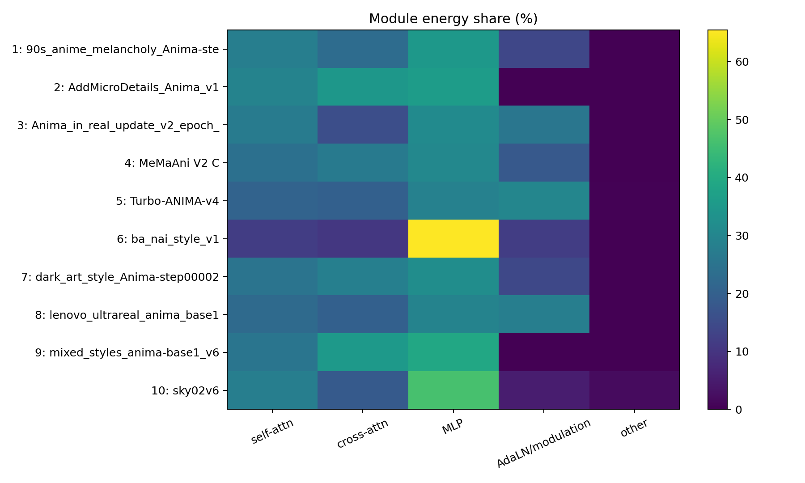
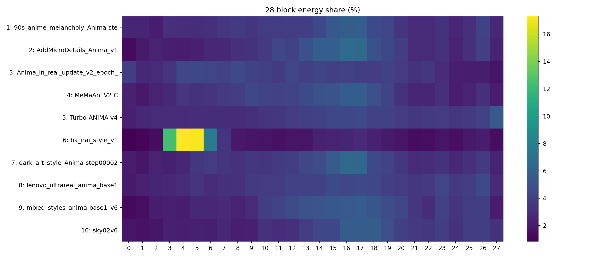

# Anima 画风权重静态分析

状态：历史调查快照
适用范围：2026-10-01 本批静态权重分析

> 历史调查快照：2026-10-01。保留当时的数值、样本与结论；此副本仅整理导航和复现说明，不代表当前代码的重新验收。

[分类导航](../README.md) · [两组汇总](../summary.md)

## 快速统计总结

全部10文件、4,132个模块完成静态有效更新分析，9个LoRA、1个LoKr；无非有限值、无遗漏或不支持模块。

在10文件共同280个attention/MLP目标内，各文件先归一化再等权统计：MLP 43.98%，self-attn 28.78%，cross-attn 27.24%。中位数分别40.66%、29.74%、28.35%；MLP均值受到ba_nai早层集中更新的影响。

共同目标下block17/16/18分别有9/10、9/10、8/10文件进入各自前五；block5仅1/10，不能当作多数画风的热点。block14–20合计平均31.86%的更新能量（7/28层）。

|文件（简称）|MLP占比|self-attn占比|cross-attn占比|更新能量前三block（0起算）|
|---|---:|---:|---:|---|
|90s anime|40.6%|32.5%|26.9%|17, 16, 15|
|MicroDetails|36.2%|29.2%|34.6%|16, 17, 15|
|Anima in real|42.3%|36.6%|21.1%|19, 17, 16|
|MeMaAni|37.4%|29.6%|33.0%|17, 16, 15|
|Turbo|41.2%|29.8%|28.9%|27, 17, 26|
|ba_nai|74.4%|13.5%|12.1%|4, 5, 3|
|dark art|37.5%|29.4%|33.1%|17, 16, 15|
|lenovo real|40.8%|31.5%|27.8%|26, 23, 15|
|mixed styles|39.4%|25.3%|35.3%|17, 16, 15|
|sky02v6|50.2%|30.2%|19.6%|18, 17, 16|

**样本差异：** ba_nai的共同目标MLP占比74.4%，前三block为4/5/3；Turbo集中于27/17/26；lenovo集中于26/23/15。多数文件的热点位于16/17/18附近，但不能外推所有画风。

**可比性边界：** AddMicroDetails、mixed_styles、ba_nai、sky声明同一完整基座hash；另外5个仅声明anima且无基座hash，Turbo无metadata，不能确认全部使用同一确切基座版本。范数未除以基座权重，因此更新占比不能直接等同量化敏感性。

**独立验收：** 三个真实权重模块直接重建ΔW与快速算法的能量相对误差分别6.11e-7、2.17e-7、1.43e-7；逐文件共同目标汇总重新计算一致，详见[independent_validation.json](evidence/independent_validation.json)。

共同目标热图：[common_targets_heatmap.png](figures/common_targets_heatmap.png)。

10 个文件；1.768 GB；CPU 最多4线程；耗时 7.2s。

分析的是 multiplier=1 时的静态等价 ΔW。它不代表量化敏感性、输出质量、画风强弱或某层的因果重要性。未加载基座/DiT、未使用 GPU、未做全量 SVD。

## 计算与保存格式

普通 LoRA：ΔW=(α/r)BA；如有 inv_scale 则先 A←A·inv_scale。范数用 trace((BᵀB)(AAᵀ))，以 FP32 计算 Gram、FP64 求和。LoKr：ΔW=(α/r)kron(W1,W2A·W2B)，能量为 (α/r)²||W1||²·||W2A·W2B||²，r 从 W2B.shape[0] 得到，不用 W1 维度代替。

读取 alpha tensor 优先；没有 tensor 的 Anima_in_real 使用 metadata ss_network_alpha=32、实际 rank=64，scale=0.5。所有这些绝对值依赖保存者的 alpha 约定；其文件内能量占比不受统一 scale 影响。配置 rank 不等于数值有效秩。

参考实时源码：networks/lora_modules/base.py:78–81；lora.py:116–131（inv_scale）；networks/plugins/lokr/module.py:179–185、418–438；networks/attn_fuse.py:52–55。归一化下划线/dot 命名，q/k/v 与 out 细分；若有 fused qkv/kv 应按其输出维度拆分。本批次没有 fused projection tensor；所有保存pair为二维Linear更新。

## 每文件摘要

|文件|类型|模块|rank|alpha|scale|参数量|ΔW能量|global Fro|delta RMS|
|---|---|---:|---|---|---|---:|---:|---:|---:|
|90s_anime_melancholy_Anima-step00003300.safetensors|LoRA|448|32–32|32–32|1–1|69,271,552|236.759|15.387|0.000349545|
|AddMicroDetails_Anima_v1.safetensors|LoRA|280|64–64|32–32|0.5–0.5|91,750,400|22.6789|4.76224|0.000113464|
|Anima_in_real_update_v2_epoch_20.safetensors|LoRA|448|64–64|32–32|0.5–0.5|138,543,104|1.36854|1.16984|2.65752e-05|
|MeMaAni V2 C.safetensors|LoRA|448|64–64|32–32|0.5–0.5|138,543,104|133.336|11.5471|0.000262315|
|Turbo-ANIMA-v4.safetensors|LoRA|454|56–64|28–32|0.5–0.5|140,009,184|4.91407|2.21677|5.01179e-05|
|ba_nai_style_v1.safetensors|LoRA|364|16–32|22.625–32|1–1.41406|54,476,800|80.1828|8.95448|0.00020577|
|dark_art_style_Anima-step00002750.safetensors|LoRA|448|32–32|32–32|1–1|69,271,552|272.886|16.5192|0.000375266|
|lenovo_ultrareal_anima_base1.safetensors|LoRA|448|16–16|16–16|1–1|34,635,776|18.5228|4.30381|9.77693e-05|
|mixed_styles_anima-base1_v6.safetensors|LoRA|280|64–64|64–64|1–1|91,750,400|75.0989|8.66596|0.000206473|
|sky02v6.safetensors|LoKr|514|32–32|32–32|1–1|18,789,440|280.547|16.7495|0.000369301|

参数量不含 alpha 标量；模块数按保存的 split target 计数；dense 参数量是所有可重建 ΔW 矩阵的元素数。完整大小、tensor 数、alpha/scale 分布、训练步数和元信息见 [per_file.csv](data/per_file.csv) / [aggregate.json](data/aggregate.json)，逐层见 [per_layer.csv](data/per_layer.csv)。

## 等权归一化统计

先按每文件总能量归一化，再对文件等权平均/中位数/四分位数；不将不同 checkpoint/scale 的原始能量混加。全部10文件和普通LoRA9文件分别列出；Turbo 按实际张量可重建成普通 LoRA，未因文件名排除。另提供普通LoRA的主28 blocks及交集目标统计，以隔离附加模块/覆盖偏差。

### all（n=10）

|模块组|均值%|中位数%|Q25–Q75%|
|---|---:|---:|---:|
|MLP|37.43|33.51|30.73–38.56|
|self-attn|24.25|25.27|23.04–27.77|
|cross-attn|23.32|21.63|18.83–28.01|
|AdaLN/modulation|14.78|14.15|6.95–23.95|
|other|0.22|0.00|0.00–0.00|

平均能量占比前5 block（0起算）：17: 5.13%（中位 5.68%）；16: 5.08%（中位 5.52%）；15: 4.70%（中位 4.80%）；5: 4.48%（中位 3.11%）；18: 4.45%（中位 4.49%）

上述 block 进入每文件 top5 次数：17: 8/10；16: 8/10；15: 7/10；5: 2/10；18: 8/10

### plain_lora（n=9）

|模块组|均值%|中位数%|Q25–Q75%|
|---|---:|---:|---:|
|MLP|36.44|32.15|30.51–36.16|
|cross-attn|23.86|23.13|20.02–28.37|
|self-attn|23.82|25.19|22.66–27.16|
|AdaLN/modulation|15.83|14.29|12.01–25.81|
|other|0.04|0.00|0.00–0.00|

平均能量占比前5 block（0起算）：17: 5.07%（中位 5.66%）；16: 5.02%（中位 5.42%）；15: 4.73%（中位 5.05%）；5: 4.73%（中位 3.22%）；4: 4.53%（中位 2.92%）

上述 block 进入每文件 top5 次数：17: 7/9；16: 7/9；15: 7/9；5: 2/9；4: 2/9

### plain_lora_main_blocks（n=9）

|模块组|均值%|中位数%|Q25–Q75%|
|---|---:|---:|---:|
|MLP|36.45|32.15|30.51–36.16|
|cross-attn|23.87|23.13|20.02–28.37|
|self-attn|23.83|25.19|22.66–27.16|
|AdaLN/modulation|15.84|14.29|12.01–25.81|
|other|0.00|0.00|0.00–0.00|

平均能量占比前5 block（0起算）：17: 5.07%（中位 5.66%）；16: 5.02%（中位 5.42%）；15: 4.74%（中位 5.05%）；5: 4.73%（中位 3.22%）；4: 4.53%（中位 2.92%）

上述 block 进入每文件 top5 次数：17: 7/9；16: 7/9；15: 7/9；5: 2/9；4: 2/9

### plain_lora_common_targets（n=9）

|模块组|均值%|中位数%|Q25–Q75%|
|---|---:|---:|---:|
|MLP|43.30|40.57|37.50–41.24|
|self-attn|28.62|29.64|29.23–31.45|
|cross-attn|28.09|28.91|26.90–33.10|
|AdaLN/modulation|0.00|0.00|0.00–0.00|
|other|0.00|0.00|0.00–0.00|

平均能量占比前5 block（0起算）：17: 5.15%（中位 5.66%）；16: 4.96%（中位 5.42%）；15: 4.69%（中位 5.14%）；5: 4.67%（中位 2.88%）；4: 4.53%（中位 2.80%）

### all_common_targets（n=10）

|模块组|均值%|中位数%|Q25–Q75%|
|---|---:|---:|---:|
|MLP|43.98|40.66|37.97–42.05|
|self-attn|28.78|29.74|29.27–31.15|
|cross-attn|27.24|28.35|22.53–33.07|
|AdaLN/modulation|0.00|0.00|0.00–0.00|
|other|0.00|0.00|0.00–0.00|

平均能量占比前5 block（0起算）：17: 5.25%（中位 5.78%）；16: 5.06%（中位 5.48%）；15: 4.68%（中位 4.87%）；18: 4.61%（中位 4.63%）；5: 4.44%（中位 2.85%）

上述 block 进入每文件 top5 次数：17: 9/10；16: 9/10；15: 6/10；18: 8/10；5: 1/10

## 覆盖、异常与限制

- 所有文件均覆盖主 DiT blocks 0–27，但 target 不同：448=每block16 targets；280=每block10个 attention/MLP targets，无AdaLN；364=每block13 targets，未覆盖AdaLN第一层；sky02v6 为514模块，包含额外 llm_adapter/embedders/final layer；Turbo为454模块，有6个主blocks外targets。
- sky02v6 为分解 LoKr，数学上可计算同维度 ΔW，但结构/覆盖不同，单独标明；rank/alpha可跨模块变化。
- Turbo-ANIMA-v4 的metadata为空，仅能根据键与shape推断Anima；实际是普通A/B+alpha保存格式，没有发现动态router/magnitude向量等额外张量。是否蒸馏/加速用途不能靠这些静态权重确认。
- lenovo 实际 tensor rank=16、alpha=16，与metadata一致；其文件体积接近rank32文件源于FP32保存，不能据文件大小推断rank。
- Anima_in_real 文件名 epoch20 与 metadata ss_epoch=1 / training_info epoch2 不一致；保留元信息，不推断文件名为实际训练epoch。
- 非finite张量 0；未使用张量 0；不支持模块 0。逐键异常列表完整保存在 [aggregate.json](data/aggregate.json)。
- block热图以各文件完整能量为分母；没有保存adapter的target不等于低敏感度。附加模块会稀释主block占比。共同target交集统计另提供，此处普通LoRA交集 280 targets。
- 更新能量还受矩阵大小影响；[per_layer.csv](data/per_layer.csv)给出 RMS，可按每元素强度补充观察。没有基座权重范数，因此没有“相对基座变化率”。

## 复现与验证

[原始分析脚本快照](scripts/analysis.py)逐字节保留，仅供取证；不能在本分类目录直接运行。脚本以 `OUT` 为自身目录、`SRC=OUT.parent` 为权重输入目录，且人物脚本的 `STYLE` 指向原画风调查的外部绝对路径。复现时应把快照复制到独立的新分析工作目录，按实际权重位置调整 `SRC`，人物分析还需调整 `STYLE` 到对应画风对照产物目录，再在项目虚拟环境中执行。重跑会重生成该工作目录的产物，不能保证保留报告中后补的解读和独立验收说明。本次归档未执行脚本、未重生成分析、未复制原始权重。

本次逐文件完整有限值检查、配对/shape检查、逐文件汇总/归一化。数学验证与文件守恒检查见 [validation.json](evidence/validation.json)。
